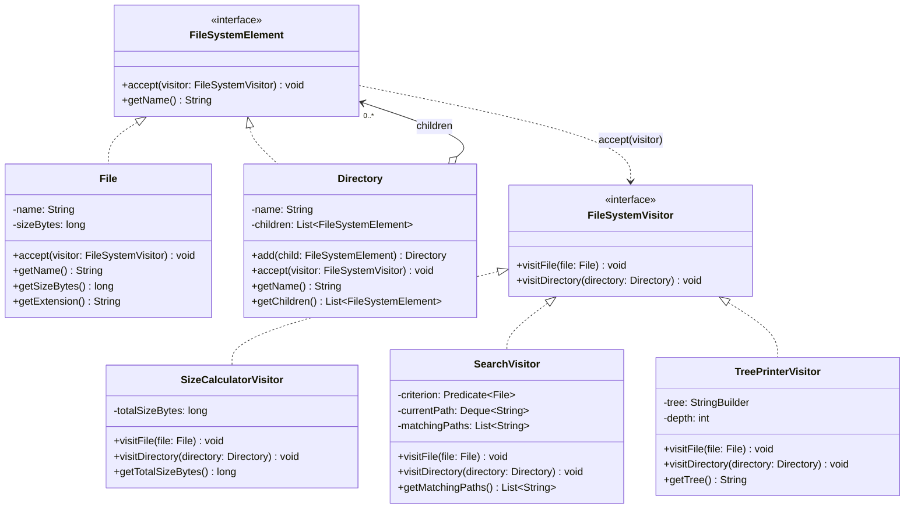

# Assignment #6 — Visitor Pattern: Report

**Course:** ShP-2216 – Software Design Patterns<br>
**Topic:** Option A — File System Visitor<br>
**Language:** Java 17, IntelliJ IDEA<br>
**GitHub repository:** [https://github.com/mrmbk-wq/Visitor-Pattern](https://github.com/mrmbk-wq/Visitor-Pattern)

---

## 1. Introduction

The object structure is a small file system. It has two kinds of elements:

- `File` — a leaf with a name and a size in bytes;
- `Directory` — a container that holds files and other directories.

This structure is stable: a file system will always consist of files and directories.
What changes is the list of **operations** we want to run over it. Instead of adding a new
method to `File` and `Directory` for every operation, each operation is written as a
separate visitor:

| Visitor                 | Operation                                                       |
|-------------------------|-----------------------------------------------------------------|
| `SizeCalculatorVisitor` | sums the sizes of all files in a directory tree                 |
| `SearchVisitor`         | collects full paths of files that match a `Predicate<File>`     |
| `TreePrinterVisitor`    | builds an indented text view of the tree (added later, see 3.5) |

**Double dispatch.** Which code runs depends on *two* types: the type of the element and
the type of the visitor. Java chooses a method by the runtime type of only one object (the
receiver), so the pattern does it in two steps:

1. The client calls `element.accept(visitor)`. The first dispatch selects
   `File.accept` or `Directory.accept` based on the element's runtime type.
2. Inside, the element calls `visitor.visitFile(this)` or `visitor.visitDirectory(this)`.
   The second dispatch selects the implementation in the concrete visitor
   (`SizeCalculatorVisitor`, `SearchVisitor`, ...).

```java
// File.java                                   // Directory.java
public void accept(FileSystemVisitor v) {      public void accept(FileSystemVisitor v) {
    v.visitFile(this);                             v.visitDirectory(this);
}                                              }
```

## 2. UML Class Diagram



`Main` is the client: it builds the `Directory` tree (the object structure), creates
visitors and calls `accept(visitor)` on the root directory.

## 3. Clean Code Principles

### 3.1 No `instanceof` / type-checking chains

**Before** (an operation written without the pattern):

```java
long totalSize(FileSystemElement element) {
    if (element instanceof File file) {
        return file.getSizeBytes();
    } else if (element instanceof Directory directory) {
        long sum = 0;
        for (FileSystemElement child : directory.getChildren()) {
            sum += totalSize(child);
        }
        return sum;
    }
    throw new IllegalStateException("Unknown element");
}
```

Every new operation would repeat the same `instanceof` chain, and a forgotten branch
would only fail at runtime.

**After** (`SizeCalculatorVisitor.java`):

```java
public void visitFile(File file) {
    totalSizeBytes += file.getSizeBytes();
}

public void visitDirectory(Directory directory) {
    directory.getChildren().forEach(child -> child.accept(this));
}
```

Double dispatch picks the right method, so the code contains no `instanceof` at all. If a
new element type were added to the interface, the compiler would force every visitor to
handle it.

### 3.2 Meaningful names that separate Element and Visitor roles

```
element/FileSystemElement   element/File   element/Directory
visitor/FileSystemVisitor   visitor/SizeCalculatorVisitor   visitor/SearchVisitor
```

Elements are in the `element` package and have domain names; every visitor is in the
`visitor` package and ends with `Visitor`. The visitor methods say which element they
handle (`visitFile`, `visitDirectory`), and the fields carry their unit or meaning:
`sizeBytes`, `totalSizeBytes`, `matchingPaths`, `currentPath`. Magic numbers are named
constants, e.g. `LARGE_FILE_BYTES = 100 * KILOBYTE` in `Main`.

### 3.3 Single Responsibility: one visitor = one operation

**Before:** every operation lives inside the element classes, so `File` and `Directory`
grow with each new feature:

```java
public class Directory {
    public long totalSize() { ... }
    public List<String> search(Predicate<File> criterion) { ... }
    public String printTree() { ... }
    public void exportToJson() { ... }   // and so on
}
```

**After:** `File` and `Directory` only describe the structure, and each visitor does
exactly one job across all element types:

| Class                   | Single responsibility                     |
|-------------------------|-------------------------------------------|
| `File`, `Directory`     | represent the file-system structure       |
| `SizeCalculatorVisitor` | compute size                              |
| `SearchVisitor`         | find matching files and build their paths |
| `TreePrinterVisitor`    | build a text view of the tree             |
| `Main`                  | build the structure and print results     |

### 3.4 Minimal, justified encapsulation trade-offs

Visitors live outside the element classes, so they can only use what elements make
public. I exposed the minimum each operation needs, and only for reading:

```java
// File.java — read-only getters, fields are private final
public long getSizeBytes() { return sizeBytes; }
public String getExtension() { ... }

// Directory.java — visitors can read the children but not change them
public List<FileSystemElement> getChildren() {
    return Collections.unmodifiableList(children);
}
```

A visitor that tries `directory.getChildren().add(...)` gets an
`UnsupportedOperationException`; the only way to change a directory is its own
`add(...)` method. The same idea is used for results: `SearchVisitor.getMatchingPaths()`
returns an unmodifiable list. `File` also validates its own data (size must not be
negative) in the constructor, so no visitor has to check it.

### 3.5 Extensibility: a third visitor without touching File/Directory

`TreePrinterVisitor` was added in a separate commit
("Add TreePrinterVisitor without modifying File or Directory"). That commit adds one new
class plus one call and one helper method in `Main`; `File`, `Directory`, `FileSystemElement` and
`FileSystemVisitor` are unchanged:

```java
public class TreePrinterVisitor implements FileSystemVisitor {
    public void visitFile(File file) {
        appendLine(file.getName() + " (" + file.getSizeBytes() / KILOBYTE + " KB)");
    }

    public void visitDirectory(Directory directory) {
        appendLine(directory.getName() + "/");
        depth++;
        directory.getChildren().forEach(child -> child.accept(this));
        depth--;
    }
}
```

This is the Open/Closed Principle for operations: open for new visitors, closed for
modification of the elements.

### 3.6 Small methods and a parameterised visitor (bonus)

Every method is a few lines long. In `Main`, each operation is wrapped in an
intention-revealing method (`printTree`, `printTotalSize`, `printSearchResult`), and
`SearchVisitor` takes the criterion as a `Predicate<File>`, so one visitor class serves
many different searches without new subclasses:

```java
new SearchVisitor(file -> file.getExtension().equals("java"));
new SearchVisitor(file -> file.getSizeBytes() > LARGE_FILE_BYTES);
```

## 4. Sample Output

Both required visitors (and the tree printer) run on the **same** structure:

```java
printTree(project);
printTotalSize(project);
printTotalSize(documents);
printSearchResult(project, "*.java files", new SearchVisitor(file -> file.getExtension().equals("java")));
printSearchResult(project, "files larger than 100 KB",
        new SearchVisitor(file -> file.getSizeBytes() > LARGE_FILE_BYTES));
```

```
project/
    src/
        Main.java (4 KB)
        Visitor.java (2 KB)
    docs/
        report.pdf (250 KB)
        uml.png (80 KB)
    images/
        logo.png (120 KB)
    README.md (3 KB)

Total size of 'project': 459 KB
Total size of 'docs': 330 KB
Search for *.java files:
  project/src/Main.java
  project/src/Visitor.java
Search for files larger than 100 KB:
  project/docs/report.pdf
  project/images/logo.png
```

Check: 4 + 2 + 250 + 80 + 120 + 3 = 459 KB, and `docs` = 250 + 80 = 330 KB.

## 5. Conclusion — Encapsulation Trade-offs

The Visitor pattern made it easy to add operations: three operations exist, and the third
one was added without editing any element class. The code has no `instanceof`, and the
compiler checks that each visitor handles every element type.

The price is **encapsulation**. Because an operation lives in a visitor instead of inside
the element, the element must expose the data the visitor needs. In this project that
meant public getters on `File` (`getSizeBytes`, `getExtension`) and a public
`getChildren()` on `Directory`. I limited the damage by keeping all fields
`private final` where possible, exposing only read access, and returning an unmodifiable
view of the children, so visitors can read the structure but not corrupt it.

The second trade-off is the opposite kind of change: adding a **new element type**
(for example `Symlink`) would require a new `visitSymlink` method in the visitor interface
and in every concrete visitor. The pattern fits this case because the file-system
structure is stable while the list of operations keeps growing.

Another design choice was who controls traversal. Here the visitor walks the children in
`visitDirectory`. This lets `SearchVisitor` keep the current path and `TreePrinterVisitor`
keep the depth, at the cost of repeating one line of traversal in each visitor.

## 6. Repository

GitHub repository: [https://github.com/mrmbk-wq/Visitor-Pattern](https://github.com/mrmbk-wq/Visitor-Pattern)
